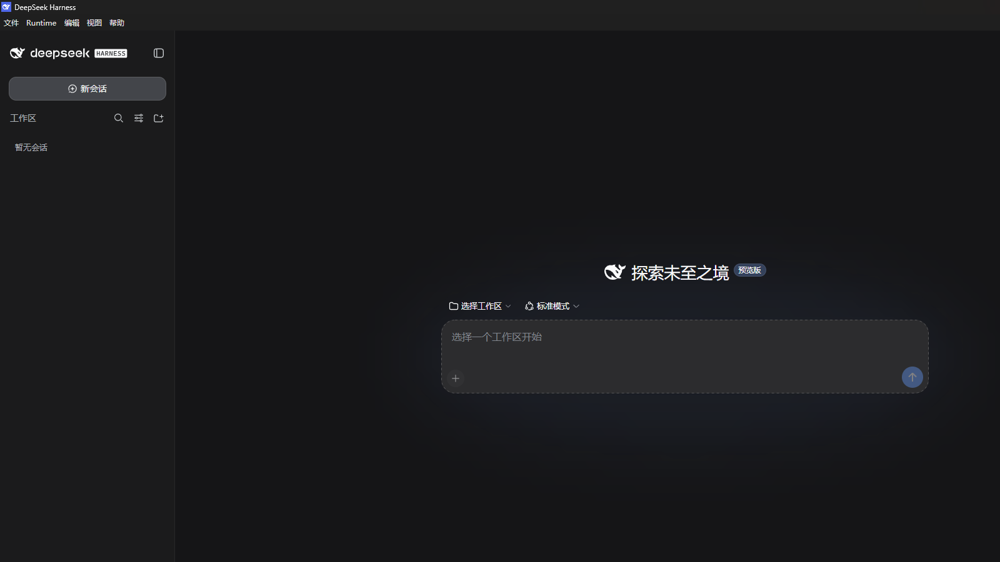

# DeepSeek Harness Desktop

[中文](README.md) | [English](README.en.md)

[](https://github.com/ToxicantX/deepseek-harness-desktop/releases/latest)
[](https://github.com/ToxicantX/deepseek-harness-desktop/releases)
[](LICENSE)

[DeepSeek Harness](https://github.com/deepseek-ai/deepseek-harness) 的 Windows 桌面客户端，用于与 AI Agent 对话、处理项目任务。应用自动安装所需运行环境，并提供插件管理、用量查看、桌面宠物和后院鱼塘。

**目前仅支持 Windows x64，普通使用无需安装 Node.js、pnpm 或 Git。**



## 下载与开始使用

1. 前往 [下载页面](https://github.com/ToxicantX/deepseek-harness-desktop/releases/latest)，选择 Windows x64 安装器，或名称含 `Portable` 的便携版。
2. 启动应用，等待自动下载并安装 DSH Runtime。首次启动需要联网并能够访问 GitHub。
3. 在 **文件 → 设置** 中配置模型提供商、API 地址和密钥，选择要使用的模型。
4. 选择或创建工作区，开始新会话。

后续启动会复用已安装的运行环境。下载或启动失败时，可根据启动页的诊断提示重试或恢复。

## 常用入口

| 想做什么 | 在哪里 |
| --- | --- |
| 配置模型和提供商 | **文件 → 设置** |
| 设置 Agent 的语言、输出风格等偏好 | **文件 → 个性化设置...** |
| 安装或更新插件、接入 MCP、管理 Skill | **Runtime → 管理插件 / 管理 MCP / 管理 Skill** |
| 更换 DSH 版本 | **Runtime → 管理 DSH 版本** |
| 配置 Exa、Perplexity 或自动选择可用搜索 | **Runtime → 搜索设置**，填写 API Key 后保存并重启 Runtime |
| 查看请求数、Token 用量和趋势 | **帮助 → 用量监控**，仅统计会话已记录的用量，不显示余额或费用 |
| 切换主题、显示或隐藏桌宠 | **视图 → 主题 / 桌面宠物** |
| 打开后院鱼塘 | 主界面的“后院鱼塘”悬浮入口，可投喂、命名锦鲤、配置和风天气并随时返回对话 |

长文本和文本文件可直接粘贴到对话输入框，发送前可以预览或移除。个性化设置会进入模型上下文，请勿填写密钥、Token 或密码。

### 可选插件

在 **Runtime → 管理插件** 中粘贴下列仓库地址即可安装，完成后到设置页配置。安装 GitHub 来源的插件需要系统已安装 Git。

| 插件 | 用途 |
| --- | --- |
| [dsh-channel-telegram](https://github.com/ToxicantX/dsh-channel-telegram) | 通过 Telegram、QQ 官方机器人或微信 iLink 私聊使用 DSH |
| [dsh-multi-model-orchestrator](https://github.com/ToxicantX/dsh-multi-model-orchestrator) | 配置多个专家 Agent，由主 Agent 分配任务 |

## 更新与数据备份

- **更新桌面客户端**：文件 → 检查更新。
- **更新 DSH Runtime**：Runtime → 管理 DSH 版本。默认自动选择最新兼容版本，也可固定版本；上游新版本需等待对应桌面运行包可用。
- **备份数据**：文件 → 打开 DSH 数据目录。完全退出应用后备份该目录，默认是 `%USERPROFILE%\.dsh`；设置过 `DSH_HOME` 时以实际目录为准。

更新客户端或切换 Runtime 不会主动删除会话、设置和插件。托盘菜单中的“退出”可完全关闭应用。

## 常见问题

**首次启动一直停在下载页？** 确认网络能访问 GitHub，按启动页提示重试。已有可用 Runtime 会被保留。

**安装插件后无法启动？** 从启动页或 **Runtime → 管理插件** 更新、禁用或移除问题插件。被自动隔离的插件可在更新后选择“重新启用并验证”。请勿直接删除整个数据目录。

**旧会话打不开？** 使用 **帮助 → 修复历史会话**，先诊断并核对备份位置，再确认修复。

**Windows 提示“未知发布者”或 SmartScreen 警告？** 请核对下载来源和文件签名，仅从本仓库发布页下载。部分构建可能未签名，具体以 Windows 显示的签名状态为准。

其他问题请提交 [Issue](https://github.com/ToxicantX/deepseek-harness-desktop/issues)，附上 **帮助 → 关于 DeepSeek Harness** 中的版本、复现步骤和脱敏后的错误信息。

## 版本与更新说明
### 0.1.67 · 2026-10-25（北京时间）

- **后院鱼塘运行中会话状态同步优化与过滤**：
  - 会话运行状态由前端页面统一聚合，采用全量快照和单调递增序列号机制（epoch + seq）向主进程派发，彻底杜绝单事件错序、乱序导致的“卡在运行中”虚假状态。
  - 支持多任务/子代理过滤与精准会话匹配，子代理（subagent）会话执行不计入主鱼塘显示，且非当前活跃主会话自动剔除。
  - 增强会话手动划走/移除时的生命周期管理，并支持页面重新加载时的全量状态重置。
- **鱼塘天气功能扩展**：
  - 接入和风天气（QWeather）API 接口，支持用户在鱼塘界面配置自定义天气服务地址与 API Key。
- **多媒体注入与工具适配优化**：
  - 修复多媒体预览中点击按钮图片时的拦截逻辑，避免误触发全屏预览。
  - 增强 `runtime-tool-compatibility`，兼顾 DSH 新旧版本的系统指令注入。

### 0.1.66 · 2026-10-24（北京时间）

- **修复长会话历史打开时界面彻底卡死（真正根因：桌面壳自身的 DOM 观察者自激循环）**：
  - 根因在 `multimedia-display-injector` 注入的 `MutationObserver`：它对 `document.body` 开启了 `subtree: true`，而回调里执行的 `enhanceMultimediaElements()` 会调用 `insertBefore` 写 DOM，从而再次触发观察者。历史会话里链接数量多，形成指数级回扫，表现为渲染线程永久不可用。
  - 更致命的是媒体卡片内部生成的“打开原始链接”本身也是 `<a href>` 且未打标记，下一轮扫描会把它当成新的媒体链接再包一层卡片，节点无限增长（实测 6 秒内新增 78 张卡片）。
  - 修复方式：注入处理中标志防止重入；观察者回调改为 `requestIdleCallback` 合并派发；对卡片内部生成的链接补打 `data-dsh-media-enhanced` 标记；链接无论是否为媒体均打标记，避免重复扫描。
  - 验证：节点普查从 2886→3276（持续增长）变为 2096→2096（零增长），会话可正常打开，不再触发无响应。
- **排查手段改进**：
  - 主进程 `unresponsive` 宽限由 20 秒放宽到 35 秒，并修正计时被重复事件重置的缺陷。
  - 超时时通过 CDP `Debugger.pause` 在 V8 层强制中断并输出真实调用栈，是定位此类死循环的关键手段（`executeJavaScript` 在死循环下永远等不到结果）。
  - 渲染端移除原先注入的限高 CSS 与定时 DOM 改写（现已改为默认关闭，仅保留只读观测），排除其与 DSH `ResizeObserver` 互相激发的可能。
- **会话历史首屏瘦身**：服务端分页的 `turnWindow` 收紧为 `{ minMessages: 6, minTurns: 1 }`（实测 `maxMessages` 并非决定性参数，`turnWindow` 先命中即 break）。


- **修复会话跨版本兼容与高版本历史读取失败（CWE-602 / 协议放行）**：
  - 修复低版本 Harness 尝试读取高版本日志（如 `session.v4.jsonl.zstd`）时，因遇到高版本新事件（如 `job/registered`、`job/settled`、`tool/ptc-dispatch`、`system/message`、`assistant/attempt`、`workspace/changes` 等）报错 `contains event type "job/registered" unknown to this harness and not marked ignorable; refusing to interpret the log` 导致历史会话打不开的问题。
  - 在桌面壳运行时加载钩子中平滑扩展已知事件白名单并放宽 `assertVersion` 日志版本检查，自动识别并安全忽略高版本专有事件，实现无缝向下兼容。
- **修复超长会话历史回写聊天区域时桌面端崩溃与白屏卡死（渲染与堆内存防护）**：
  - 为桌面主进程及 Chromium 渲染进程扩充 V8 堆内存上限（`--max-old-space-size=4096`），彻底避免一次性反序列化巨量会话事件导致的渲染器 OOM 硬崩溃。
  - 注入零侵入会话视口虚拟化与 DOM 保护机制（`createSessionHistoryVirtualizerScript`）：通过 Chromium 原生 `content-visibility: auto` 与滚动包含（CSS Containment）对超出安全数量的旧历史轮次进行视口外渲染优化，并对过长的工具文本输出进行高度与重排限制，消除超大 DOM 爆炸引发的渲染进程无响应（unresponsive）崩溃。
- 全程无需修改 DSH 核心代码，不影响短会话体验，保证上下各版本间 100% 平滑兼容。

### 0.1.65 · 2026-10-22（北京时间）

### 2026-10-22 21:05 - 适配 DSH 0.2.1-rc.1 工具系统指令注入与兼容性适配

- **问题排查与修复**：
  - **现象分析**：在启动 DSH 0.2.1-rc.1 时，底层模块加载输出了 `桌面壳工具兼容检查未匹配当前 Runtime，保留原模块：.../@deepseek-ai/dsh-tools/lib/index.js`；若叠加首次插件解析/冷启动 I/O 耗时或超时，该警告成为唯一的错误诊断信息。
  - **根因定位**：DSH 0.2.1-rc.1 将 `@deepseek-ai/dsh-tools` 中的系统提示词由旧版的静态变量 `const SDK_PROGRAM_INSTRUCTIONS = \`Inside the program:\n\`` 重构为按格式动态渲染函数 `function renderSdkProgramInstructions(programFormat) { return \`Inside the program:\n\` }`。原桌面壳注入逻辑 `adaptRuntimeToolPrompt` 未包含该动态渲染锚点，导致规则未被注入并触发警告。
  - **修复实现**（`src/runtime-tool-compatibility.ts`）：
    - 扩展 `adaptRuntimeToolPrompt`，同时兼容旧版静态声明锚点与 DSH 0.2.1+ 的 `return \`Inside the program:\n\`` 动态函数返回值锚点；
    - 保持既有的 Windows 路径正斜杠规范、编辑工具上下文与长文件写入等增强指令完整注入。
- **测试与构建验证**：
  - 新增单测用例 `tests/runtime-tool-compatibility.spec.ts` 覆盖 `renderSdkProgramInstructions` 格式适配与防重复注入断言；
  - 实机对真实已安装的 DSH 0.2.1-rc.1 进行端到端 backend 启动与停止验证，子进程在 7.4 秒内就绪并解析 URL，且无 stderr 兼容性警告；
  - 同步更新本地开发 `lib/` 产物及已安装桌面应用的 `shutdown-hook.js`；
  - `pnpm test` 全量 62 个测试文件、520 个测试用例全部通过；`pnpm run build` 成功。

### 2026-10-22 16:38 - 鱼塘实时天气接入和风天气 API 并支持用户自定义配置

- **需求内容**：
  - 把后院鱼塘自动获取实时天气的接口从 Open-Meteo 替换为和风天气（QWeather）API 接口。
  - 不在源码中硬编码私密 API 凭证，支持用户在鱼塘页面中自行填写、持久化保存与清空自己的 API 域名与 Key。
- **实现细节**：
  - **主进程与 IPC 桥接**（`src/koi-pond-window.ts` & `src/koi-pond-preload.ts`）：
    - `fetchQWeather` 采用 IP 经纬度定位（精确到两位小数 `lon,lat`），接入和风天气 `/v7/weather/now` 实时天气端点；
    - 支持外部传入自定义 `host` 与 `key`，在未配置时安全跳过天气同步，已配置时自动规范化 URL；
    - 解析返回的 `now.icon`、`now.text`、`now.precip`（降水量）及温度 `now.temp`。
  - **天气状态映射与动效**（`assets/koi-pond.js`）：
    - 新增 `mapQWeatherToWeather(icon, text, precip)`，将和风天气的数十种状况代码与文字精准映射为鱼塘现有的 8 种天气状态（晴天、阴天、小雨、中雨、暴雨、小雪、中雪、大雪）；
    - 联动既有池塘水波、雨滴涟漪、雪花消融粒子与专属日间/夜间雨雪底图；
    - 保留 `mapWmoToWeather` 保证老版本接口与测试向后兼容。
  - **页面交互与配置面板**（`assets/koi-pond.html` & `assets/koi-pond.css`）：
    - 顶部工具栏天气下拉选框增加配置入口齿轮按钮 `#weather-config-btn`；
    - 新增庭院古典风格和风天气配置模态弹窗 `#weather-config-modal`，提供域名与 Key 输入框、保存并同步、清空配置、取消关闭及 ESC 快速退出；
    - 配置项本地持久化保存在 `localStorage`（`koi-pond-weather-api-host` / `koi-pond-weather-api-key`）。
- **测试与构建验证**：
  - `pnpm test`：全部测试用例通过。
  - `tests/koi-pond-weather.spec.ts` 专项扩充和风天气状态映射及 UI 配置控件断言，全数通过。
  - `pnpm run build`（含 `tsc --noEmit` 与 tsdown 打包）：退出码 0，预加载与主进程构建无类型错误。
  - `git diff --check`：无语法或空白格式缺陷。

### 0.1.64 · 2026-10-21 20:59（北京时间）

- 新增 **Runtime → 搜索设置**，支持 Exa、Perplexity 和原有 DSH 搜索；自动模式会跳过缺少凭据的渠道，继续使用已配置的搜索。
- 搜索密钥使用系统加密保存，设置窗口不回显已保存的密钥。保存应用前会确认重启 Runtime，正在运行的任务会中断。
- 修复 MCP 发现工具参数格式不兼容导致 WorkBuddy 首条请求返回 `11129 invalid function call parameters` 的问题。
- 更新桌面壳并重启后生效，会话、模型与插件配置保留。

### 0.1.63 · 2026-10-20 17:53:49（北京时间）

- 修复 0.1.62 中 `search_mcp_tools` 与 `get_mcp_tool_schema` 在真实运行时直接报错的问题：这两个工具把编写期使用的 DSL 直接当作原始注册表输出 schema 使用，而该 DSL 从未经过编译，使 schema 类型停留在 `json`、却按编译后的 DSL 结构处理，出现无法到达的分支，调用即抛错。
- 两个工具改为使用原始输出 schema `{}`（不附加编译期约束），明确允许 `object` 与 `null` 两种结果，使正常摘要与空结果都能通过输出校验。
- 本次仍只涉及工具 schema 的呈现与校验；MCP 服务的 instructions／使用指导依旧由已安装的 `dsh-mcp-client` 全局注入上下文，既不压缩或改写既有对话历史，也不改动 MCP 连接与进程生命周期（MCP 进程仍随现有运行时启动，不属于懒启动）。
- 回归验证已通过：覆盖搜索、schema 命中、未找到返回 `null`、原始 MCP 调用，以及非法 schema 的负向对照（执行体被触达后按预期失败，随后恢复）。源码与重新构建的 `lib/shutdown-hook.js` 均已在真实安装的 0.2.1-rc.2 `ToolRuntime.execute` 上、经真实调度器与输出校验路径通过；相关 focused 测试 8/8 通过，`pnpm run build` exit 0。上述验证使用本地内存 fixture，未替换当前安装版，也不代表外部 MCP 服务或真实模型会话的端到端结论。
- 使用方式：更新桌面壳并重启后端后生效，不会热更新或替换当前正在运行的安装版。

### 0.1.62 · 2026-10-20 17:19:40（北京时间）

- MCP 工具改为按需暴露 schema：初始上下文不再携带全部 MCP 工具定义，改为“先有界搜索、再取单个 schema”的两段式获取，以减少工具声明占用的上下文。该思路参考 Mcp-Dynamic-Router，未接入其服务，由桌面壳通过运行时加载自行实现。
- 新增两个发现入口：`search_mcp_tools` 只返回简短摘要，默认 5 条、硬上限 10 条，支持关键词与 server 过滤，空查询时按页浏览；`get_mcp_tool_schema` 按需返回单个工具的完整原始 schema。
- 初始 PTC SDK 与原生工具声明均不含完整 MCP 目录；精确查询后，每个 agent 在原生模式最多激活最近按需读取的 5 个工具 schema（以显式 schema 读取排序，与实际工具执行无关）。PTC 仍使用静态生成的 SDK，保留原有 `tools[name]` 调用与绑定写法。
- 本次仅延后工具 schema 的暴露；MCP 服务的 instructions／使用指导并未延后，仍由已安装的 `dsh-mcp-client` 全局注入上下文，因此不属于完整的 MCP 按需加载。
- 未替换原有注册表权限，也未改动原有调用、审批、取消和结果链路；MCP 连接与进程仍按现有运行时启动，不属于懒启动。更新桌面壳并重启后端后生效，不会热更新到当前正在运行的安装版。
- 上述 5 个 schema 的上限只约束当前原生模式下的 schema 呈现，不会改写历史消息或提供商侧已记录的工具声明，也不会自动压缩既有对话上下文，不能保证上下文不会耗尽。

### 0.1.61 · 2026-10-18 18:27（北京时间）

- 桌面壳通过运行时加载适配，让 Grok 改用宿主已有的原生工具呈现路径，不修改已安装 DSH 核心源文件，也不再要求模型通过 run_code 编写 TypeScript 调用工具；按每个主会话或子代理当前实际模型独立选择，其他模型保留原有模式。
- 工具声明、系统提示和执行准入共用同一原生路径，保留原有权限和工具可见范围；不静默裁剪 MCP 工具或回退 PTC，工具数量超过已知接口限制时输出诊断。
- 撤回会改写模板字符串内容的全局 import/export 自动转换与 require 注入，移除上一版仅靠提示词约束 Grok 的方案；保留原有工具兼容功能，并增加 PTC 模块不改写的边界回归测试。
- 原生模式、父子代理隔离和模型切换已有 focused 测试覆盖；已在 0.2.1-rc.2 独立进程中验证 xapi/grok-4.7 从 initial PTC 自动切为 native，实测范围为 25 个基础工具，read 和 pwsh 两次真实调用状态均为 completed。完整 MCP 工具集尚未实测；安装此版本并重新启动后端后生效，不会自动替换当前正在运行的安装版。

### 2026-10-17 12:28（北京时间）

- 精简使用指南，集中展示下载、首次配置、常用入口、更新和排障信息，同步英文版。

### 近期更新

- **0.1.65**：修复超长会话历史回写崩溃与页面白屏卡死，实现高低版本历史会话无缝向下兼容。
- **0.1.64**：新增 Exa、Perplexity 搜索设置和自动渠道回退，修复 MCP 参数格式导致的 WorkBuddy 11129 报错。
- **0.1.63**：修复 `search_mcp_tools` 与 `get_mcp_tool_schema` 在真实运行时的原始输出 schema 校验失败。
- **0.1.62**：MCP 工具 schema 改为有界搜索与按需读取，服务 instructions／使用指导仍全局进入上下文。
- **0.1.61**：修复 Grok 主会话与子智能体的原生工具调用适配，其他模型保持原有模式。
- **0.1.60**：修复打开工作区目录后按钮无法再次点击的问题。
- 支持自定义图片生成协议、图片放大预览和音视频播放；生成能力取决于所配置的提供商与模型。
- 子智能体对话页显示模型信息；优化鱼塘背景和任务状态显示。

完整版本记录见 [Releases](https://github.com/ToxicantX/deepseek-harness-desktop/releases)。

## 代码签名政策

SignPath Foundation 批准并启用集成后，符合条件的桌面客户端发布将使用 [SignPath.io](https://about.signpath.io) 提供的免费代码签名，证书由 [SignPath Foundation](https://signpath.org) 持有。详见[完整代码签名政策](docs/code-signing-policy.md)。

## 开发者说明

需要 Windows x64、Node.js 24 和 pnpm 11：

```powershell
pnpm install --frozen-lockfile
pnpm test
pnpm run typecheck
pnpm run build
pnpm run start
pnpm run dist
```

`build-windows.bat` 会优先使用已安装 DSH Runtime 中的 Node.js 24 x64，其次查找 nvm 和 PATH。pnpm 优先使用 PATH 中的版本；PATH 未安装 pnpm 时，脚本会根据所选 Runtime 的 `runtime-manifest.json` 复用其独立 pnpm，最后才尝试 Corepack。只有这些位置都没有兼容工具时才需要另行安装 Node.js 24 x64 或 pnpm 11。

构建完整 Runtime：

```powershell
./scripts/build-runtime.ps1 `
  -DshTag dsh-v0.1.0-rc.7 `
  -OutputDirectory "$PWD/runtime-output" `
  -RuntimeRevision 1 `
  -RequiredShellRange '>=0.1.0 <1.0.0'
```

`.github/workflows/runtime-release.yml` 会验证上游 Tag 与 CLI 版本，安装精确的官方 `@deepseek-ai/dsh`、Node 24 和独立 pnpm，运行真实 Web、设置打开、会话修复、插件及关闭冒烟，再发布 ZIP、Manifest 和 Catalog 更新。同一 DSH Version 只能以更高 Runtime Revision 更新。

公开分发应使用 Windows 信任 CA 签发的 Authenticode 证书。`shell-v*` Tag 构建可通过 `CSC_LINK` 和 `CSC_KEY_PASSWORD` 交给 electron-builder 签名；硬件或云端保护的私钥应接入对应远程签名服务，不应复制到仓库或 GitHub Secret。没有证书时，本地 `dist` 保持未签名。

## 当前范围

- 仅支持 Windows x64。
- 当前 Shell 最低兼容 DSH Version 为 `0.1.0-rc.7`。
- Runtime Release 始终标记为 GitHub Prerelease，不会替换 electron-updater 使用的 Shell Latest Release。
- DSH Web 只通过临时 loopback Origin 打开；Host 与插件运行在下载的标准 Node Runtime 中。
